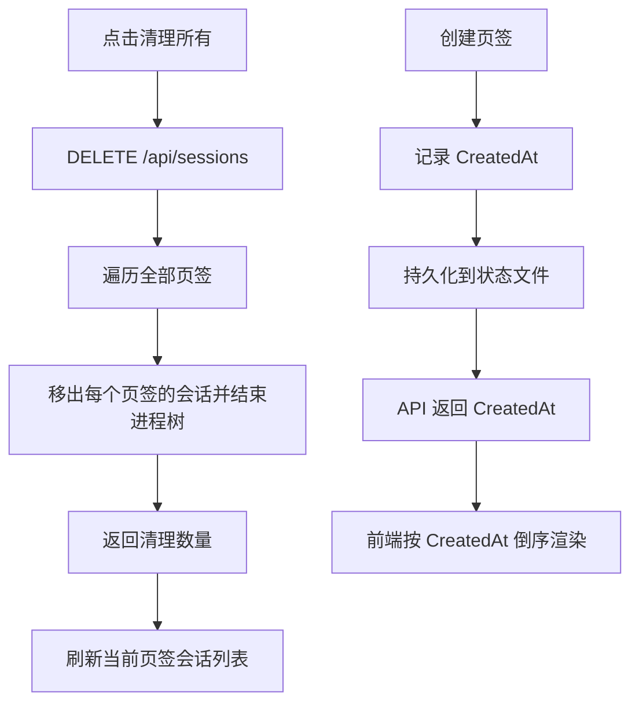

# 清理所有 pprof 子进程与页签倒序方案

## 需求

1. 增加清理所有 pprof 子进程的功能：一次结束所有页签中由本应用启动的 pprof 进程，并刷新当前页签的进程列表。
2. 左侧页签栏按加入时间倒序排列：最新加入的页签显示在最上方，旧状态文件也能正常加载。

## 实现思路

### 后端

- 为 `browserTab` 和 `persistedTab` 增加 `CreatedAt` 字段，并在新建页签时写入当前时间。
- 读取旧状态时：若 `CreatedAt` 缺失，根据原有页签顺序生成稳定的递增时间，保证旧数据可用且排序确定。
- `tabSummary` 返回加入时间，`handleListTabs` 在返回前按加入时间倒序排列；创建、删除、重命名等响应沿用同一排序规则。
- 注册无 `tabId` 的 `DELETE /api/sessions`，调用现有跨页签清理逻辑；保留带 `tabId` 的接口兼容当前页签清理。
- 为关键清理和排序路径补充中文日志及单元测试。

### 前端

- 左侧栏渲染前按 `createdAt` 倒序排序，并以页签 ID 作为相同时间的稳定次序。
- 将“清除全部”按钮改为全局清理，调用不带 `tabId` 的接口；清理完成后刷新当前页签会话列表并记录清理数量。
- 保留当前页签进程列表的展示和空状态、错误处理。

## 执行计划

- [x] 增加页签加入时间字段、旧状态兼容及倒序 API 返回。
- [x] 增加全局清理 pprof 进程接口与前端按钮调用。
- [x] 补充/调整 Go 与前端相关测试。
- [x] 使用 `playwright-cli` 验收页面交互，并运行 Go 测试与构建应用。

## 验收标准

- 点击清理按钮后，所有页签的 pprof 子进程均被结束，返回并显示实际清理数量。
- 新建多个页签后，左侧栏最新页签在最上方；重启应用后顺序保持。
- 旧版本状态文件没有加入时间字段时仍可启动、展示和创建页签。
- `go test ./...` 通过，应用构建成功，网页交互无控制台错误。
